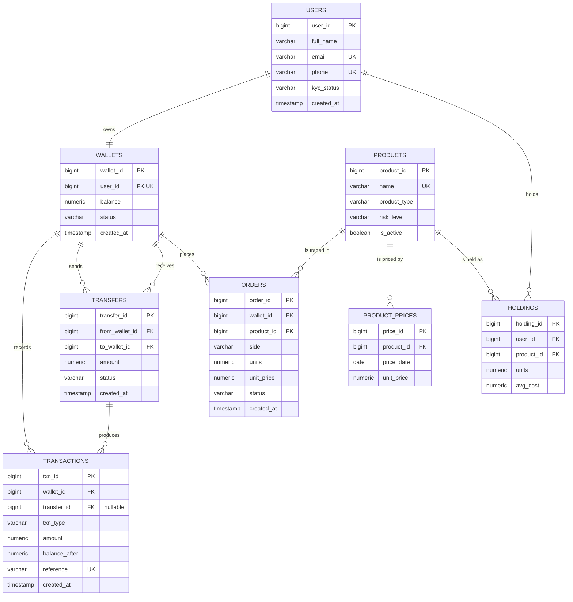

# Portfolio 1: ER Diagram

## Entities

| Entity | Purpose |
|---|---|
| users | Investors and their KYC status |
| wallets | One naira wallet per user, holds the balance |
| transfers | Wallet-to-wallet movement of money |
| transactions | Ledger. Every balance change is a row |
| products | Investment products (fund, T-bill, mutual fund) |
| product_prices | Daily unit price per product |
| orders | Buy and sell orders |
| holdings | Units of each product a user owns |

Notifications and activity events are not in the relational model. They go to MongoDB in Portfolio 4.

## Relationships

- One user has one wallet (1:1)
- One wallet has many transactions (1:N)
- One wallet sends many transfers and receives many transfers (1:N each)
- One transfer produces two ledger rows: one debit, one credit (1:N)
- One product has many daily prices (1:N)
- One wallet places many orders (1:N)
- One product appears in many orders (1:N)
- Users and products are linked through holdings (M:N resolved by the holdings table)

## Diagram

## Design decisions

- `balance` sits on `wallets` for fast reads. The ledger in `transactions` is the source of truth. An audit query compares the two.
- `balance_after` on each ledger row makes the audit trail easy to check.
- `reference` is unique, so a retried request cannot post twice.
- `transfers` is separate from `transactions`. A transfer is one business event. It creates two ledger rows.
- `holdings` has a unique pair (`user_id`, `product_id`), so a user has one row per product.
- `product_prices` has a unique pair (`product_id`, `price_date`), so a product has one price per day.
